# Aegis Command

[](pictures/aegis-tour.webm)

A readiness coordination tool for a county fire and rescue department: who is on duty, which apparatus can respond, what is open, and what needs attention. FastAPI and PostgreSQL behind a Next.js interface, with an outbox-to-Kafka event pipeline, Redis fan-out to WebSockets, and OIDC roles.

The tour is a recording of the running application against the seeded synthetic data ([1080p WebM](pictures/aegis-tour.webm)). `node dashboard/scripts/record-tour.mjs` regenerates both files from a running dashboard, and `node dashboard/scripts/capture-readme.mjs` regenerates the screenshots below.

## Contents

- [What it does](#what-it-does)
- [Run it](#run-it)
- [Architecture](#architecture)
- [Frontend](#frontend)
- [Backend](#backend)
- [Tests and what they cover](#tests-and-what-they-cover)
- [Known limits](#known-limits)
- [Repository map](#repository-map)
- [Disclaimer](#disclaimer)

## What it does

### The map

The county overview is the landing page, and the map is the center of it. Station and incident markers are real buttons, every layer is a toggle, and the selection lives in the URL.

<table>
<tr>
<td width="50%" valign="top"><a href="pictures/readme/overview.jpg">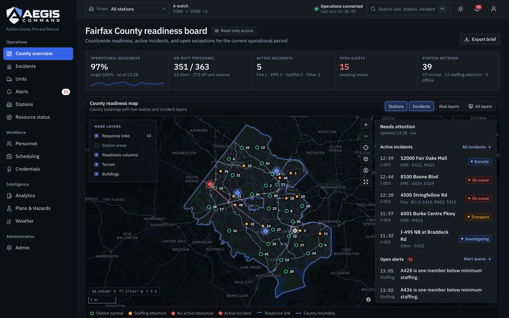</a><br><b>County overview</b> · <code>/</code><br>Readiness, on-duty staffing, active incidents, and open alerts above a WebGL county map, with the queue of what needs attention docked beside it.</td>
<td width="50%" valign="top"><a href="pictures/readme/stations.jpg">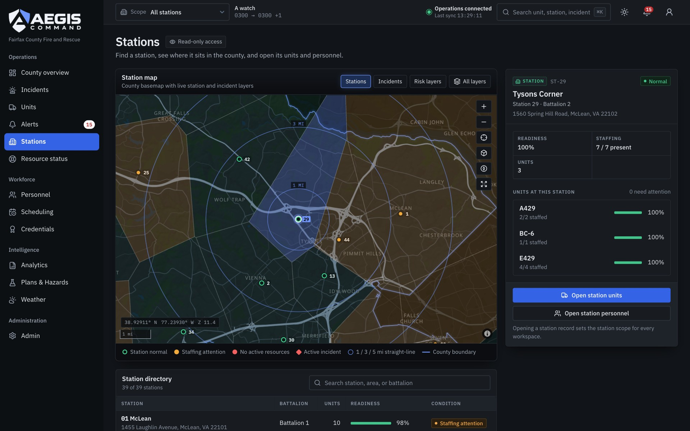</a><br><b>Stations</b> · <code>/?layer=stations</code><br>Search the 39-station directory; the list, the map, and the station panel stay on the same selection.</td>
</tr>
<tr>
<td width="50%" valign="top"><a href="pictures/readme/map-3d.jpg">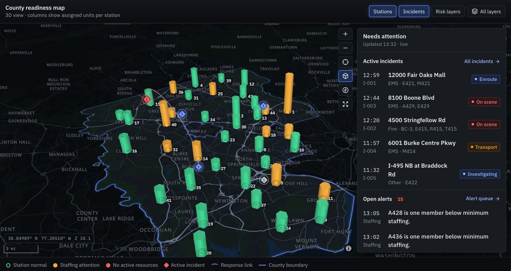</a><br><b>3D readiness</b> · <code>/</code><br>One toggle tilts the map; each station rises as a column whose height is its assigned units and whose color is its staffing condition.</td>
<td width="50%" valign="top"><a href="pictures/readme/map-station.jpg">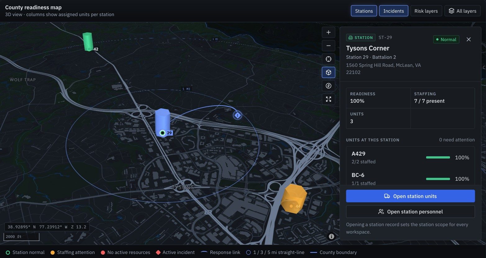</a><br><b>Station fly-in</b> · <code>/?station=fs-29</code><br>Selecting a station flies the camera to it, draws 1, 3, and 5-mile straight-line rings, and opens its readiness, staffing, and units in the inspector.</td>
</tr>
<tr>
<td width="50%" valign="top"><a href="pictures/readme/map-areas.jpg">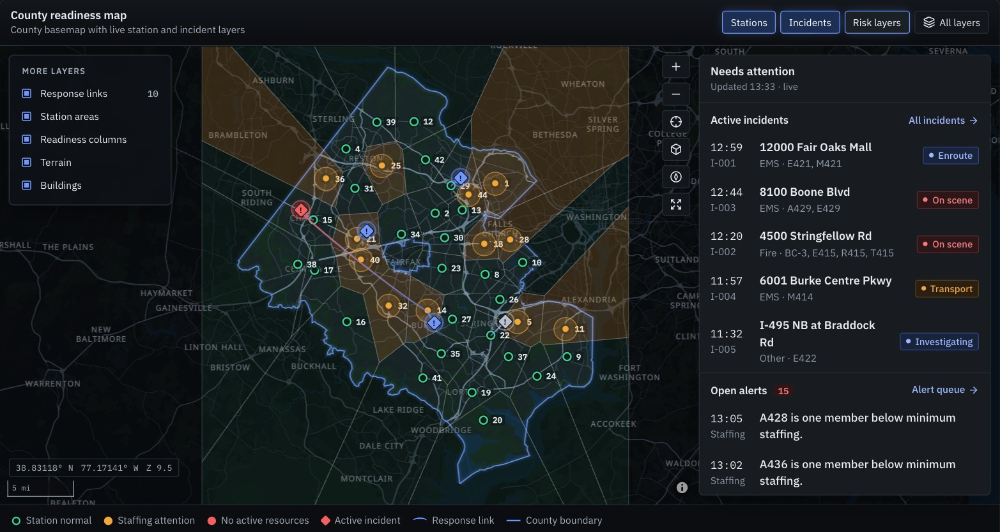</a><br><b>Station areas and risk</b> · <code>/</code><br>Nearest-station areas split the county by straight-line distance; risk rings mark stations with staffing or readiness attention.</td>
<td width="50%" valign="top"><a href="pictures/readme/map-scrubber.jpg">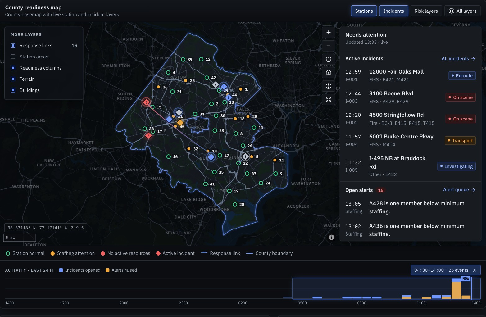</a><br><b>24-hour activity scrubber</b> · <code>/</code><br>Draw a window across the last day of incidents and alerts; the map and the attention queue filter to it.</td>
</tr>
<tr>
<td width="50%" valign="top"><a href="pictures/readme/incidents-map.jpg">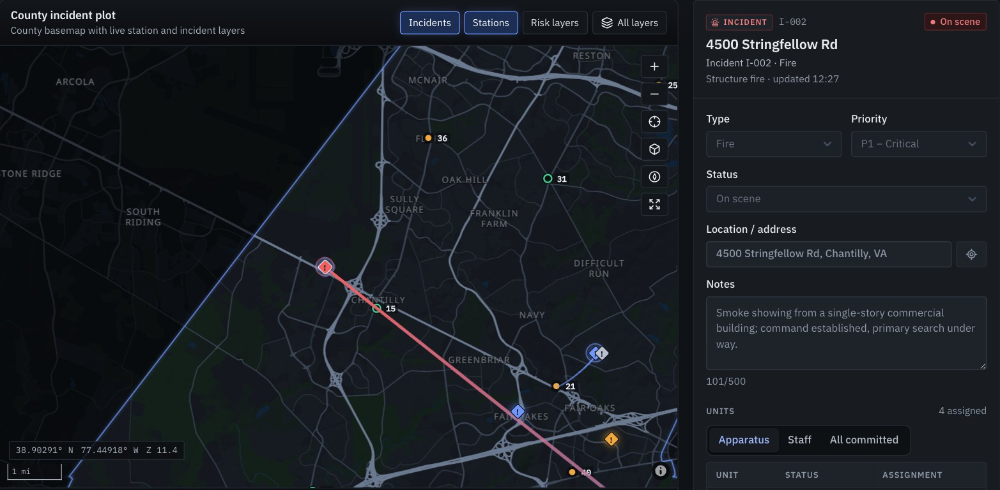</a><br><b>Incident map</b> · <code>/readiness?view=incidents&amp;pane=map</code><br>Active incidents with response links back to the home station of every assigned unit. The register, map, and timeline share one selection.</td>
<td width="50%" valign="top"><a href="pictures/readme/overview-light.jpg">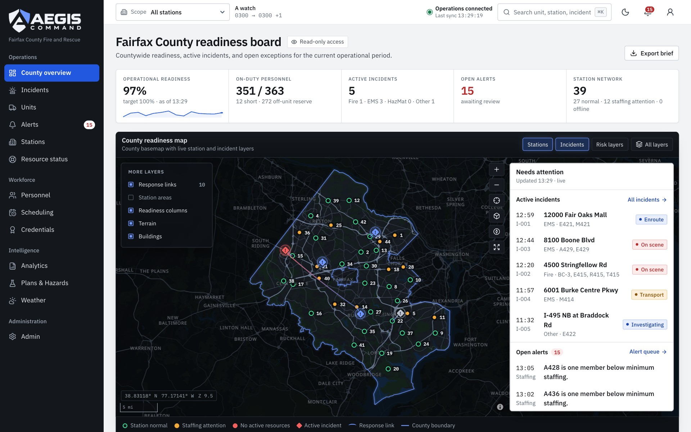</a><br><b>Light theme</b><br>Dark by default, light on the toggle. The map stage stays dark in both, so space and time read the same way.</td>
</tr>
</table>

### Operations

<table>
<tr>
<td width="50%" valign="top"><a href="pictures/readme/incidents.jpg">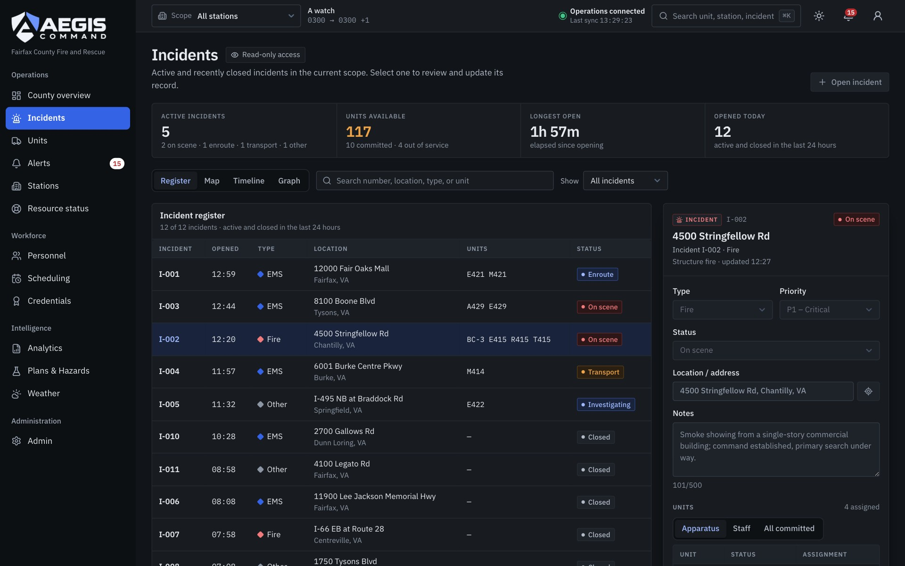</a><br><b>Incidents</b> · <code>/readiness?view=incidents</code><br>Edit an incident, add notes, assign units, and resolve it from the register and its worksheet.</td>
<td width="50%" valign="top"><a href="pictures/readme/incident-timeline.jpg">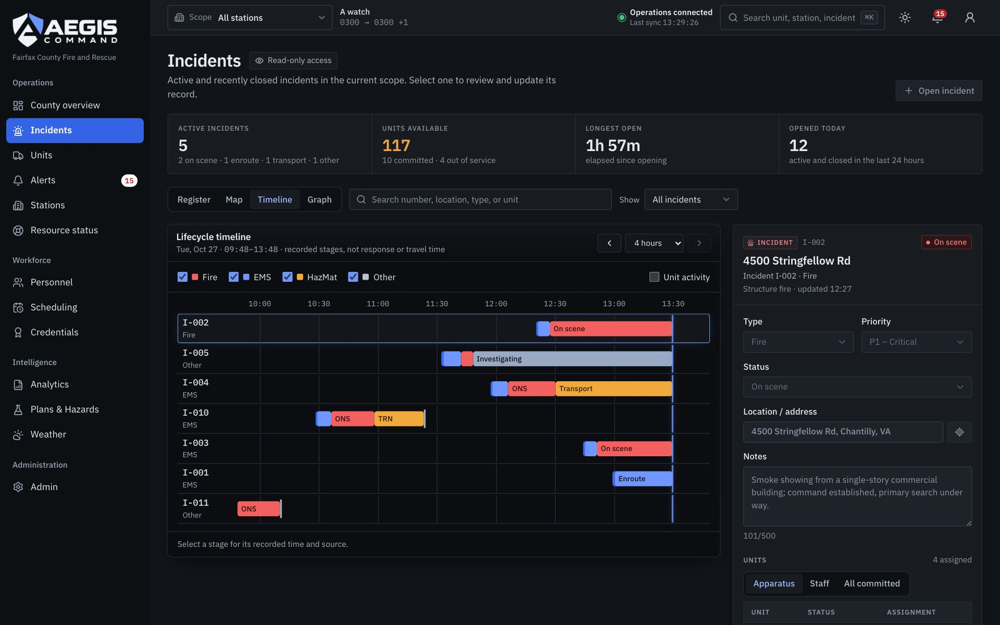</a><br><b>Incident lifecycle</b> · <code>&amp;pane=timeline</code><br>Each stage comes from recorded audit events. Time with no record is shown as unrecorded rather than assumed.</td>
</tr>
<tr>
<td width="50%" valign="top"><a href="pictures/readme/incident-graph.jpg">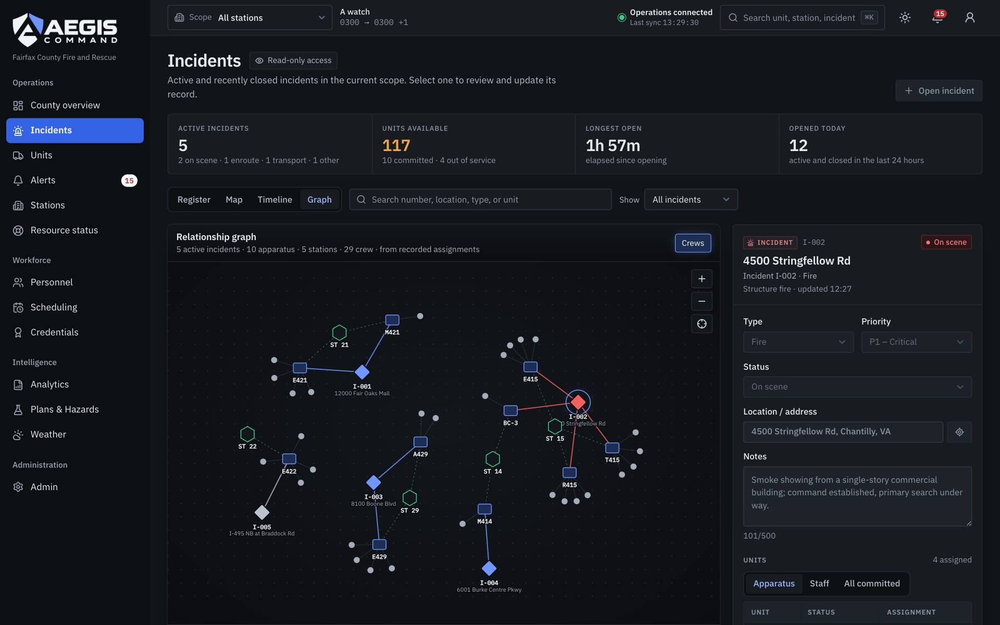</a><br><b>Relationship graph</b> · <code>&amp;pane=graph</code><br>Incidents, apparatus, crews, and stations linked by recorded assignments. Selecting a node selects the record everywhere.</td>
<td width="50%" valign="top"><a href="pictures/readme/units.jpg">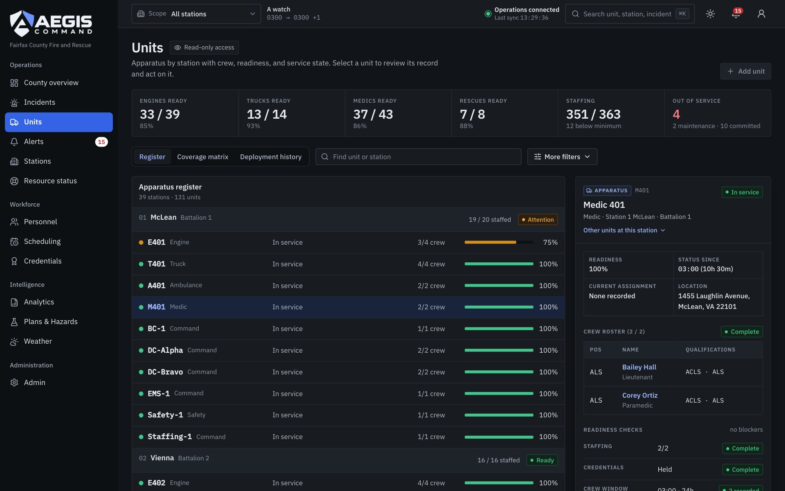</a><br><b>Units</b> · <code>/readiness?view=units</code><br>Crew and readiness per apparatus. Assign crew and record out-of-service, maintenance, and return.</td>
</tr>
<tr>
<td width="50%" valign="top"><a href="pictures/readme/units-history.jpg">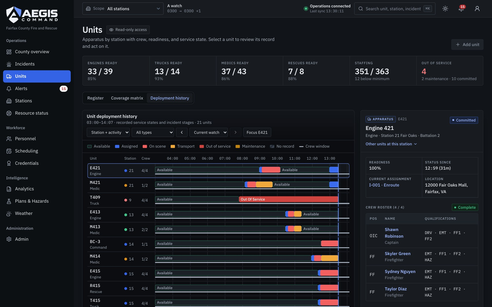</a><br><b>Deployment history</b> · <code>&amp;pane=history</code><br>Service states for every apparatus over time, rebuilt from the audit trail, with a crosshair that reads out the moment under the cursor.</td>
<td width="50%" valign="top"><a href="pictures/readme/alerts.jpg">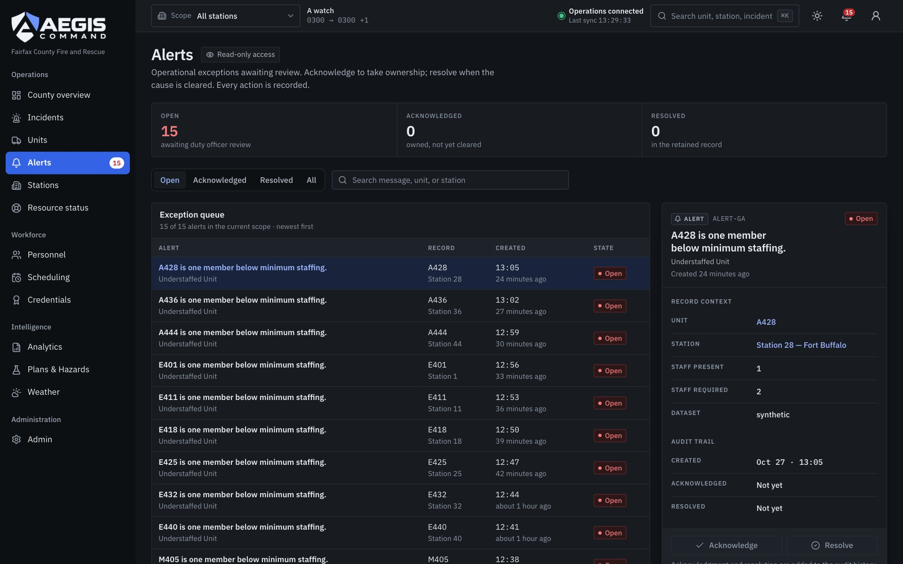</a><br><b>Alerts</b> · <code>/readiness?view=alerts</code><br>Filter by state, acknowledge, and resolve. Each alert links to the record it is about.</td>
</tr>
</table>

### Workforce and analysis

<table>
<tr>
<td width="50%" valign="top"><a href="pictures/readme/shifts.jpg">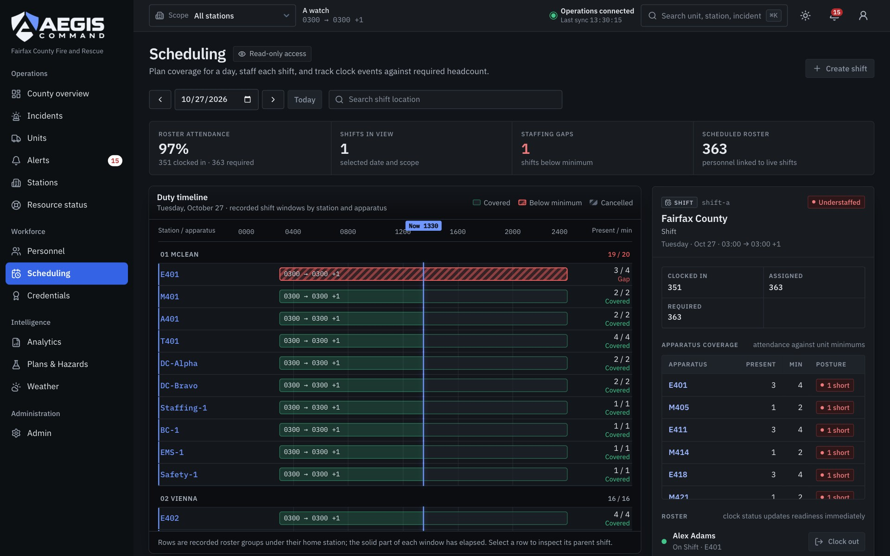</a><br><b>Scheduling</b> · <code>/shifts</code><br>The day's duty timeline shows coverage gaps. Create and cancel shifts, manage the roster, clock people in and out.</td>
<td width="50%" valign="top"><a href="pictures/readme/personnel.jpg">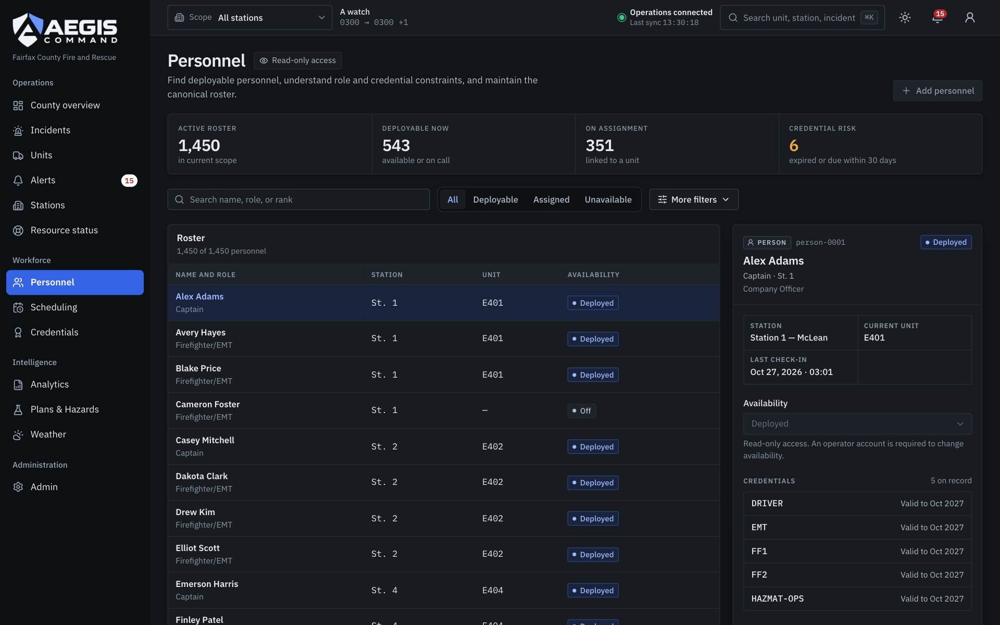</a><br><b>Personnel</b> · <code>/personnel</code><br>Search the roster, edit profiles and availability, and archive records.</td>
</tr>
<tr>
<td width="50%" valign="top"><a href="pictures/readme/credentials.jpg">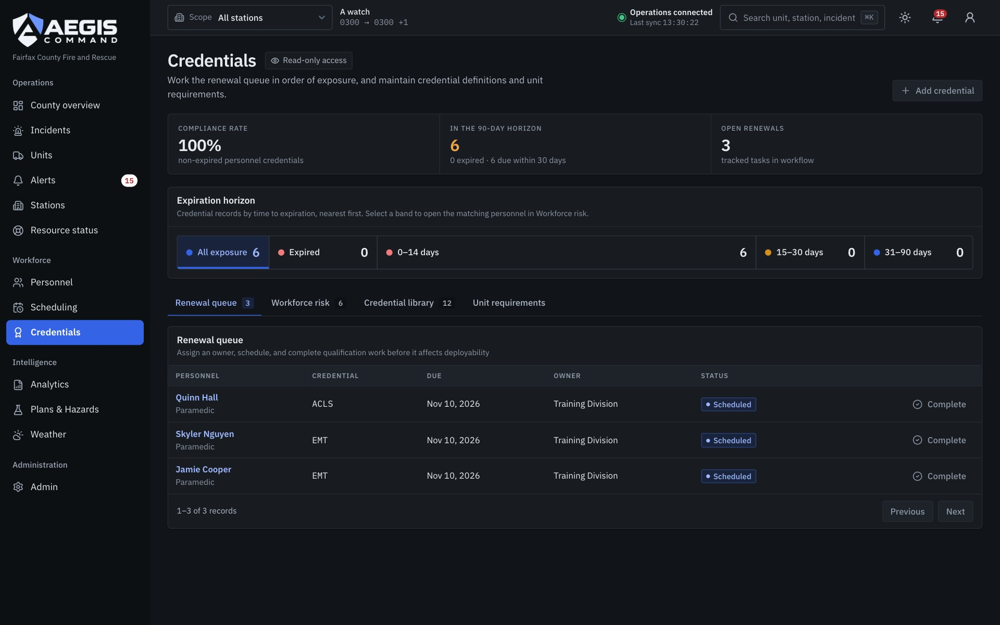</a><br><b>Credentials</b> · <code>/certifications-management</code><br>Work the renewal queue by expiration and maintain credential definitions and unit requirements.</td>
<td width="50%" valign="top"><a href="pictures/readme/analytics.jpg">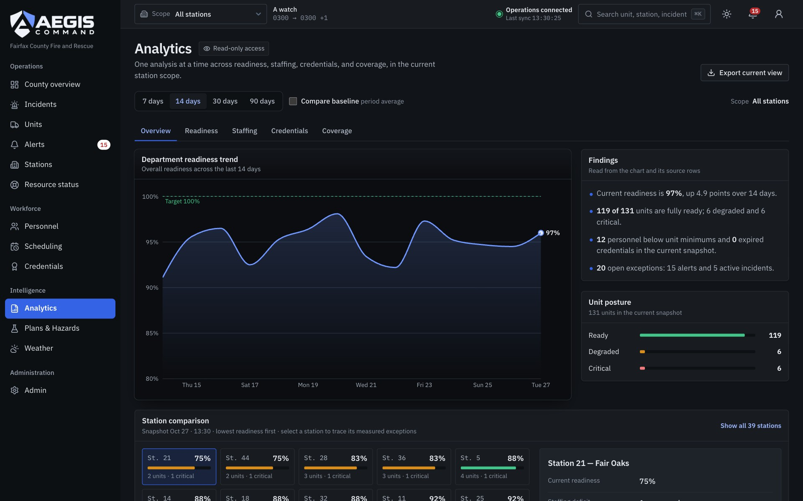</a><br><b>Analytics</b> · <code>/analytics</code><br>Readiness, staffing, credential, and coverage analyses, one at a time, with CSV export of the evidence.</td>
</tr>
<tr>
<td width="50%" valign="top"><a href="pictures/readme/plans.jpg">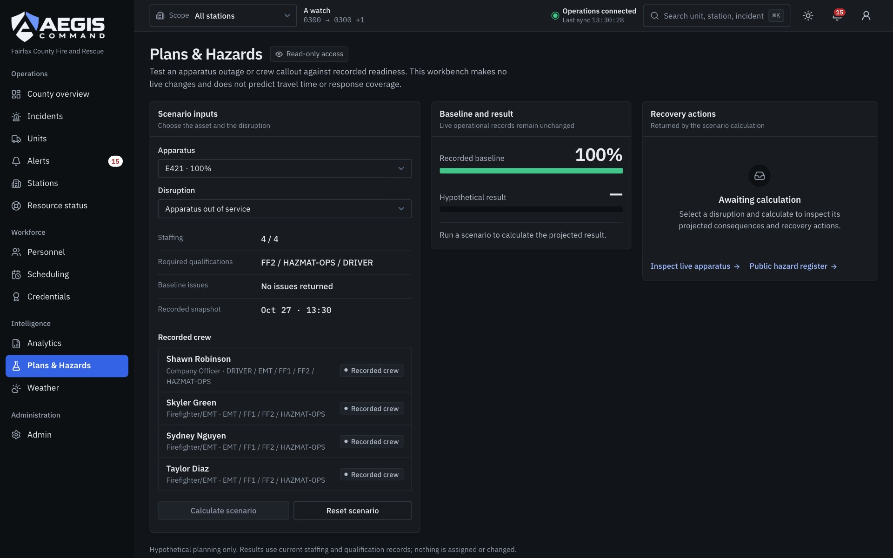</a><br><b>Plans &amp; Hazards</b> · <code>/readiness?view=simulation</code><br>Run a what-if for an apparatus outage or crew callout and see degraded readiness and recovery actions. Nothing is written.</td>
<td width="50%" valign="top"><a href="pictures/readme/weather.jpg">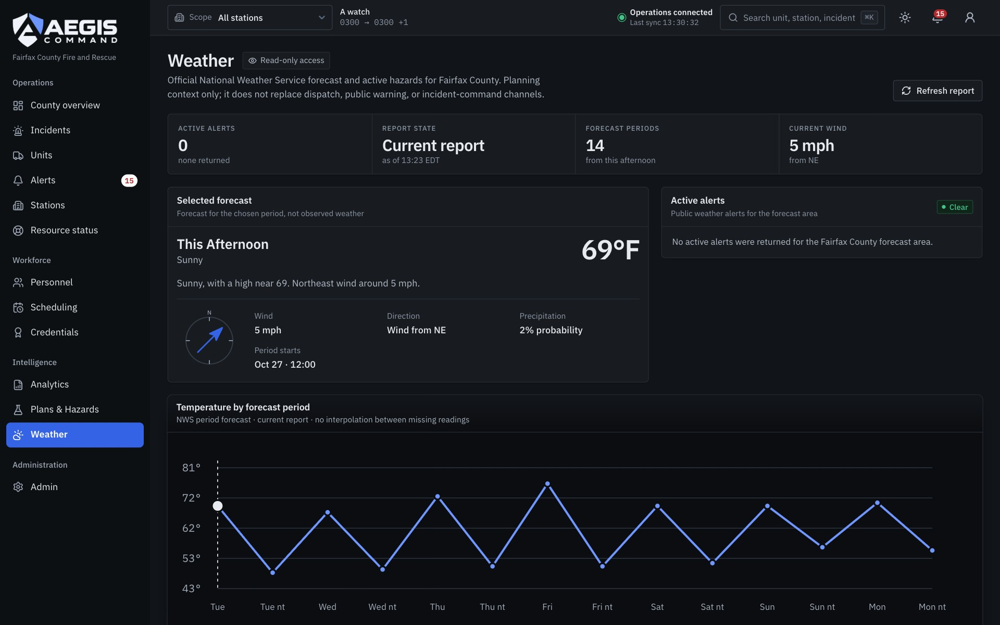</a><br><b>Weather</b> · <code>/weather</code><br>National Weather Service forecast and active alerts, with explicit stale and unavailable states.</td>
</tr>
<tr>
<td width="50%" valign="top"><a href="pictures/readme/admin.jpg">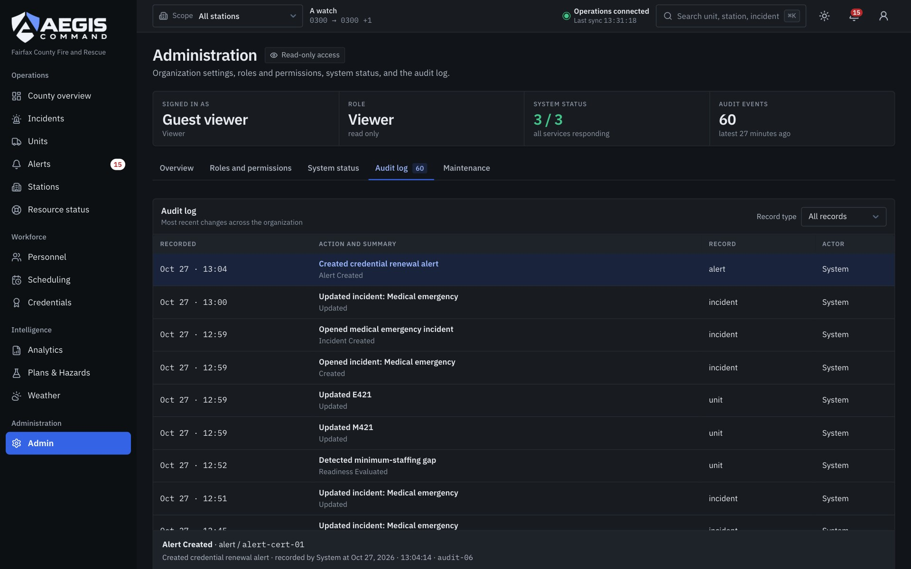</a><br><b>Admin</b> · <code>/admin</code><br>Organization, roles and permissions, system status, the audit log, and baseline data restore.</td>
<td width="50%" valign="top"><br><b>Also</b><br><b>Resource status</b> (<code>/?panel=resources</code>) compares apparatus, special-team, and supply availability. <b>Command search</b> (⌘K) finds workspaces, stations, units, and active incidents. The overview exports a handover brief.<br><br>Every workspace also works from 320px up; full-page desktop and mobile captures from the browser test suite are in <a href="pictures/">pictures/</a>.</td>
</tr>
</table>

## Run it

### Option 1: frontend and API only (fastest)

No Docker, Kafka, or identity provider. The API uses SQLite and seeds synthetic data on first start. The session is read-only: write controls are visible but disabled.

```bash
cd backend
python -m venv venv && source venv/bin/activate
pip install -r requirements.txt
SNOWFLAKE_ACCOUNT=placeholder SNOWFLAKE_USER=placeholder SNOWFLAKE_PASSWORD=placeholder \
  uvicorn app.main:app --reload --port 8000
```

```bash
cd dashboard
npm install
npm run dev
```

Open http://localhost:3000. Requires Python 3.11+ and Node.js 20+.

### Option 2: full local stack

```bash
docker compose up --build -d
```

Starts PostgreSQL, the migration and seed job, Redis, Redpanda, Keycloak, the API, the outbox and bridge workers, and the dashboard on port 3000. The default is still read-only. To sign in and change records, follow the [local operator profile](docs/security.md#local-operator-profile). The local credentials in that profile must never be deployed.

Port 3000 matters for this option: the Keycloak redirect URI and the API's CORS origin are both set to `http://localhost:3000`.

### Configuration

Copy [.env.example](.env.example). The two settings most people touch:

| Variable | Effect |
|---|---|
| `NEXT_PUBLIC_API_BASE_URL` | Where the dashboard finds the API. Defaults to `http://localhost:8000`. |
| `NEXT_PUBLIC_OIDC_AUTHORITY` | Empty means no sign-in screen and a read-only public session. Set it to the Keycloak realm URL to require sign-in. |

With `KAFKA_BOOTSTRAP_SERVERS` or `SNOWFLAKE_ACCOUNT` set to `placeholder`, those integrations fall back to local stand-ins. That is useful for interface work and is not evidence that the real integrations work.

## Architecture

```
Browser ──HTTP──▶ FastAPI ──▶ PostgreSQL (records + outbox, one transaction)
   ▲                               │
   │                        outbox worker
   │                               ▼
   │                 Kafka topics (alerts / events / audit)
   │                               │
   │                        bridge workers
   │                               ▼
   └──── WebSocket ◀── FastAPI ◀── Redis pub/sub

Kafka ──▶ Snowflake connector ──▶ RAW ──▶ Streams & Tasks ──▶ ANALYTICS
```

- **Writes** commit the record and its outbox row together, so an event is never published for a change that did not happen.
- **Alerts** travel on their own topic so bulk events cannot delay them.
- **The browser** opens `/ws/operations` with a short-lived ticket and treats every message as a signal to refetch. The 15-second snapshot is the recovery path if events are missed.
- **Tenancy** is enforced in PostgreSQL with row-level security as well as in the API.

Details: [docs/architecture.md](docs/architecture.md), [docs/security.md](docs/security.md).

### Measured, on one laptop

From [backend/benchmarks/](backend/benchmarks/README.md), through the real PostgreSQL → Kafka → Redis → WebSocket path:

| Offered load | Delivered | Alert latency p95 |
|---|---|---|
| 100 events/s | 1,000 of 1,000 | 28.953 ms |
| 500 events/s | saturated near 183 accepted/s | 1,094 ms (misses the 200 ms target) |

No claim is made about consumer-lag reduction or production scale.

## Frontend

Next.js 16 (App Router), React 19, TypeScript, TanStack Query, Zod, Radix primitives, Recharts, MapLibre GL, deck.gl, and d3-force. The interface is dark by default with a light theme on the toggle; the design system is documented in [DESIGN.md](DESIGN.md).

**Where things are**

| Path | Contents |
|---|---|
| `dashboard/app/styles/tokens.css` | Every color, radius, shadow, and font as a CSS custom property. |
| `dashboard/app/styles/ui.css` | Shared component classes, all prefixed `ui-`. |
| `dashboard/components/ui.tsx` | Shared React components: `PageHeader`, `SummaryStrip`, `Panel`, `Inspector`, `StatusBadge`, `Filters`, loading, empty, and error states. |
| `dashboard/components/*.module.css`, `dashboard/app/*.module.css` | Layout that belongs to one workspace. |
| `dashboard/components/GeoMap.tsx`, `MapView.tsx` | The WebGL county map. MapLibre draws a custom dark basemap from [OpenFreeMap](https://openfreemap.org) vector tiles (OpenStreetMap data, no API key) with AWS Terrain Tiles hillshade and 3D buildings; deck.gl draws response arcs, readiness columns, nearest-station areas, and distance rings. Station and incident markers are real buttons, so they are keyboard-reachable and testable. `MapView` loads it client-only and falls back to the SVG map when WebGL is unavailable. |
| `dashboard/lib/map/` | The basemap style (built from the `--map-*` tokens), station helpers, and layer definitions. |
| `dashboard/components/CountyMap.tsx` | The offline SVG fallback map, projected from a committed geometry file. |
| `dashboard/components/TimeScrubber.tsx`, `LinkGraph.tsx` | The activity histogram that filters by time, and the force-directed relationship graph. |
| `dashboard/lib/api.ts`, `dashboard/lib/schemas.ts` | The typed API client. Every response is parsed with Zod; a response that fails parsing is an error, not a silent `undefined`. |
| `dashboard/lib/history.ts` | Rebuilds unit service states and incident lifecycles from audit events. Time with no record is returned as "unrecorded" rather than assumed. |

**Conventions worth knowing before changing anything**

- **Selection lives in the URL.** `?incident=`, `?unit=`, `?alert=`, `?station=`, `?person=`, and `?pane=` are how a selected record survives a reload and how other pages link to it. The register, map, and timeline all read the same parameter.
- **One inspector component.** `Inspector` renders beside the workspace from 1280px and as a full-height drawer below that. Pages do not implement their own detail panels.
- **Write controls use `WriteButton`.** It stays visible and disables itself with an explanation when the session cannot write. The server enforces permissions regardless.
- **Destructive and state-changing actions go through `ConfirmDialog`.** A failed action keeps the dialog open with the error and the input intact.
- **Summary figures are only colored past a threshold.** `ratioTone` in `dashboard/lib/utils.ts`: plain at 85% and above, warning from 60%, critical below.
- **Color never carries state alone.** Every badge has a word.
- **Realtime updates refetch; they do not replace state.** Selection, scroll position, and unsaved form input survive an update.

## Backend

FastAPI with Pydantic v2 models, SQLAlchemy over PostgreSQL (SQLite for the lightweight profile), Alembic migrations.

- **67 method/path operations** in the OpenAPI document. Swagger UI is at `/docs` on the running API.
- **Readiness score** per unit, in `backend/app/services/readiness_service.py`: staffing ratio as a percentage, minus 15 per missing required credential, minus 20 per expired credential, floored at zero.
- **Permissions** come from OIDC roles. `GET /api/v1/session` reports `can_write` and `can_reset_demo` for the caller, and the interface gates controls on that.
- **Audit events** record status changes with before and after values. The incident and unit timelines are built from these, not from separate timeline tables.
- **Alert lifecycle:** `OPEN → ACKNOWLEDGED → RESOLVED`.
- **What-if simulation:** `POST /api/simulations/staffing-gap` returns original and degraded readiness plus recovery actions and writes nothing.
- **Weather:** `GET /api/weather/fairfax` caches National Weather Service data and reports `live`, `stale`, or `unavailable` explicitly.

## Tests and what they cover

```bash
make check-harness                                        # docs, links, plan structure
cd backend && python -m unittest discover -s tests -v     # 55 tests
cd dashboard && npm run lint && npx tsc --noEmit && npm run build
cd dashboard && npm run test:e2e                          # 29 scenarios × Chromium and Firefox
```

`npm run test:e2e` builds the dashboard, starts it and the API against a throwaway SQLite database, and runs the scenarios in both browsers. They cover:

- every workspace loading real data in under 10 seconds with no console errors
- selection staying in sync across register, map, timeline, and URL, including after reload and back navigation
- filters, pagination, command search, CSV and brief downloads
- read-only sessions: every write control disabled
- a failed request showing a retry that works; stale and unavailable weather; the not-found page
- no horizontal page scroll at eight widths from 320px to 1920px
- no serious or critical axe findings at desktop and mobile widths
- 44px touch targets on mobile, and drawers that close on Escape and return focus

There is a second suite for signed-in workflows (create, edit, assign, resolve, cancel, archive as an operator; denied writes as an analyst):

```bash
cd dashboard && npx playwright test -c playwright.auth.config.ts
```

It needs the Docker stack running and port 3000 free.

**Current status.** As of October 2026: the harness check, 55 backend tests, lint, type check, production build, and all 58 browser runs pass. The signed-in suite was updated for the current interface but has not been re-run against it. See [docs/quality.md](docs/quality.md) for the dated record.

## Known limits

- **Snowflake is not verified against a live account.** The SQL in `data-pipeline/snowflake/` is checked for structure only. See its [README](data-pipeline/snowflake/README.md).
- **Throughput saturates near 183 events/s** on the local stack (table above).
- **Analytics are descriptive.** Station comparison and trends describe current and recorded state. Nothing predicts response times or coverage.
- **The map is not for navigation.** It is public GIS geometry drawn for context.
- **Admin response checks only show that the browser received a valid response.** They are not infrastructure health probes.
- **The basemap needs network access.** Tiles come from OpenFreeMap and terrain from AWS; offline, the map keeps the county boundary and markers, and without WebGL it falls back to the SVG map.
- **Map areas and rings are straight-line.** Nearest-station areas and 1/3/5-mile rings are geometric, not drive-time or response coverage.

## Repository map

```
backend/
  app/api/          REST routes
  app/services/     readiness, credentials, recommendations, weather, Kafka, Snowflake
  app/db/           SQLAlchemy models and tenant-scoped store
  app/security/     OIDC identity, tenant context, realtime tickets
  app/workers/      outbox publisher, Kafka-to-Redis bridge
  migrations/       Alembic
  tests/            unit and PostgreSQL integration tests
  benchmarks/       pipeline load tests and recorded results
dashboard/
  app/              routes, tokens, shared styles
  components/       shell, shared components, workspace components
  lib/              API client, schemas, history reconstruction
  tests/e2e/        browser scenarios
  tests/auth/       signed-in workflows
data-pipeline/snowflake/   warehouse SQL
infra/                     Keycloak realm, PostgreSQL runtime role
docs/                      architecture, security, quality record, execution plans
```

Further reading: [PRODUCT.md](PRODUCT.md) for scope and constraints, [DESIGN.md](DESIGN.md) for the interface system, [PROJECT_GUIDE.md](PROJECT_GUIDE.md) for how changes are planned and checked.

## Disclaimer

Aegis Command is an unofficial portfolio project. It is modeled on Fairfax County Fire and Rescue using 39 public station locations and public county GIS geometry, but every unit, person, incident, shift, credential, and alert is synthetic. It is not affiliated with or endorsed by Fairfax County, and it is not a dispatch, CAD, or patient-care system. Sources and provenance are in [docs/target-research.md](docs/target-research.md).

## License

MIT © Devon Arnone
